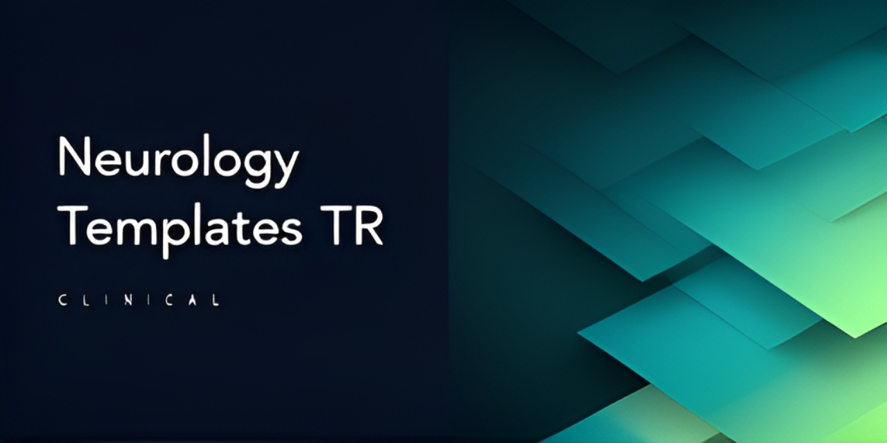

# Neurology Clinic Templates

<!-- aegean:media:start -->
<p align="center"></p>
<p align="center"><a href="LICENSE"></a> <a href="https://github.com/AegeanWorks/AIKit"></a></p>
<!-- aegean:media:end -->


This project provides standardized anamnesis (patient history) templates for common complaints in neurology practice. Its purpose is to make the patient assessment and documentation processes more efficient, complete, and systematic for clinicians (neurologists, resident physicians, medical students).

## 30-Second Cold-Start Quick Reference

- **Runtime Prerequisites**: None; 0 runtime dependencies, any text editor or Markdown viewer is enough (Python 3 is not required).
- **Canonical Regression Shield Gate**:
  ```bash
  python aikit.py check NeurologyClinicTemplates-TR
  ```

### AIKit Commands (run from the AIKit workspace root)
| Role | Command |
|---|---|
| Status, task and gates | `python aikit.py status NeurologyClinicTemplates-TR` |
| Delivery check (clean tree + map) | `python aikit.py check NeurologyClinicTemplates-TR` |
| Repair memory and map, then check | `python aikit.py fix NeurologyClinicTemplates-TR` |
| Resume an interrupted task | `python aikit.py resume NeurologyClinicTemplates-TR` |

## What's Inside

```text
NeurologyClinicTemplates-TR/
├── README.md
├── .gitignore               <- AIKit transient state exclusions
├── COMMERCIAL.md
├── LICENSE
├── LICENSES/                 <- REUSE license texts
├── REUSE.toml                <- Machine-readable SPDX metadata
├── .aikit/                  <- project memory: project, guidelines, decisions, ledger
├── tests/                   <- regression tests for template pairing and references
├── assets/                  <- reviewed brand and social-preview images
├── Anamnesis/               <- anamnesis .txt templates and _Açıklama.md explanations
└── ConsultationNotes/       <- consultation note templates
```

## Project Structure

For each neurological complaint, there are two types of files:

1.  **`.txt` Template File:** A clean anamnesis template ready to be copied and pasted directly into patient notes or Electronic Health Record (EHR) systems.
2.  **`_Açıklama.md` Explanation File:** A detailed guide explaining the clinical reasoning behind each question, examination finding, and planning step in the template, its importance in differential diagnosis, and potential "red flags".

### Available Templates

*   **Headache:** `BaşAğrısı.txt` & `BaşAğrısı_Açıklama.md`
*   **Dizziness / Vertigo:** `BaşDönmesi.txt` & `BaşDönmesi_Açıklama.md`
*   **Idiopathic Intracranial Hypertension (IIH):** `BIH.txt` & `BIH_Açıklama.md`
*   **Dementia / Forgetfulness:** `Demans.txt` & `Demans_Açıklama.md`
*   **Epilepsy Follow-up:** `EpilepsiTakip.txt` & `EpilepsiTakip_Açıklama.md`
*   **Essential Tremor:** `EsansiyelTremor.txt` & `EsansiyelTremor_Açıklama.md`
*   **Restless Legs Syndrome:** `HBS.txt` & `HBS_Açıklama.md`
*   **Eyelid Myokymia:** `Miyokimi.txt` & `Miyokimi_Açıklama.md`
*   **Multiple Sclerosis / Optic Neuritis:** `MultiplSkleroz-OptikNörit-Ön-Tanı.txt` & `MultiplSkleroz-OptikNörit-Ön-Tanı_Açıklama.md`
*   **Parkinson's Disease:** `ParkinsonHastalığı.txt` & `ParkinsonHastalığı_Açıklama.md`
*   **Syncope / Seizure / Epilepsy Differential:** `Senkop-Nöbet-Epilepsi-Ön-Tanı.txt` & `Senkop-Nöbet-Epilepsi-Ön-Tanı_Açıklama.md`

## How to Use

*   **In Clinical Practice:** You can take a quick and complete history by copying the content of the relevant `.txt` file and pasting it into your patient record system.
*   **For Educational Purposes:** By reading the corresponding `_Açıklama.md` file, you can learn why certain questions are asked when evaluating a symptom, which findings point to which diagnoses, and current diagnostic criteria (e.g., SNOOP, HINTS, Modified Dandy).

## Key Features

*   **Standardization:** Ensures that critical questions are not missed for any patient.
*   **Efficiency:** Speeds up the documentation process in a busy outpatient clinic setting.
*   **Educational:** The explanation files describe the thought process from symptom to diagnosis step-by-step.
*   **Current and Evidence-Based:** The templates include internationally accepted diagnostic tools and criteria such as SNOOP (headache), HINTS (dizziness), Modified Dandy (IIH), ILAE 2017 seizure classification, MDS tremor and Parkinson criteria, IRLSSG 2014 restless legs criteria, McDonald 2017 multiple sclerosis criteria and ESC 2018 syncope guidance. Each explanation file lists its key sources.
*   **Turkish and Adapted for Local Practice:** Prepared entirely in Turkish, considering the needs of healthcare professionals in Turkey.

---

## ⚠️ Important Disclaimer

All templates and explanations in this repository are for **educational and informational purposes only.** These documents do not substitute for professional medical advice, diagnosis, or treatment.

*   **Not a Substitute for Clinical Judgment:** These templates are not designed to replace a clinician's individual patient assessment and clinical judgment. Every patient is unique, and the evaluation must be tailored to the patient's specific situation.
*   **Responsibility:** All responsibility for patient care, diagnosis, and treatment decisions lies with the licensed healthcare professional evaluating the patient. The developers of this project cannot be held responsible for any consequences arising from the use of these templates.
*   **For Guidance Purposes:** The templates should be used as a reminder guide when taking an anamnesis. A patient's condition may require additional questions or examinations not included in the template.
*   **Not Professional Training:** These materials are not part of formal medical education or specialty training and should not be considered as such.

**By using these templates, you declare that you have read, understood, and accepted the above terms.**

---

## Contributing

We welcome your suggestions and contributions to improve this project. To suggest new templates, improve existing ones, or correct errors, please open an "Issue" or submit a "Pull Request".

<!-- aegean:brand-assets:start -->
## 🎨 Brand Assets

> **AI-Generated Brand Artwork.** The banner and logo are **AI-generated brand assets**. They are illustrative and may not literally depict every feature or the full project scope.
<!-- aegean:brand-assets:end -->

## 📜 License

Free for personal use under the Aegean License 1.1 (AL-1.1); see [LICENSE](LICENSE). Any commercial use needs the Aegean Commercial License 1.0 (ACL-1.0); see [COMMERCIAL.md](COMMERCIAL.md).
